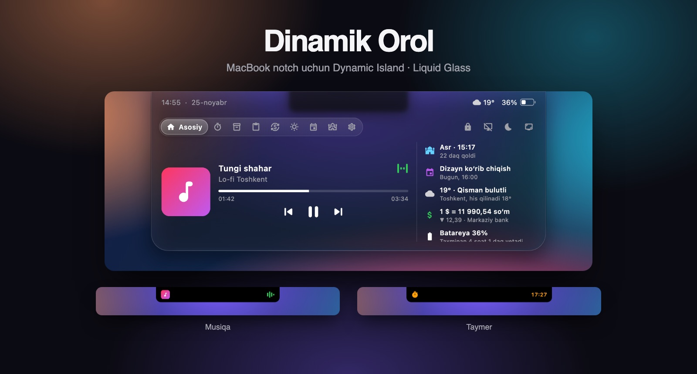
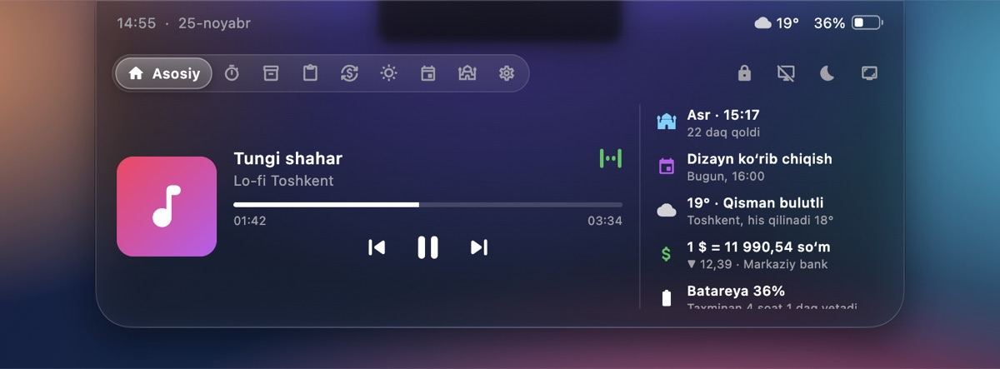
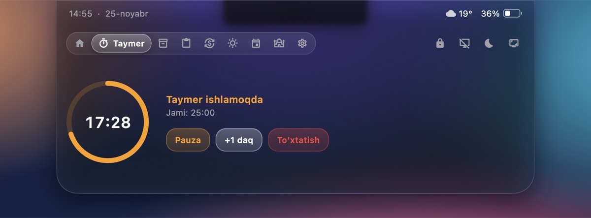
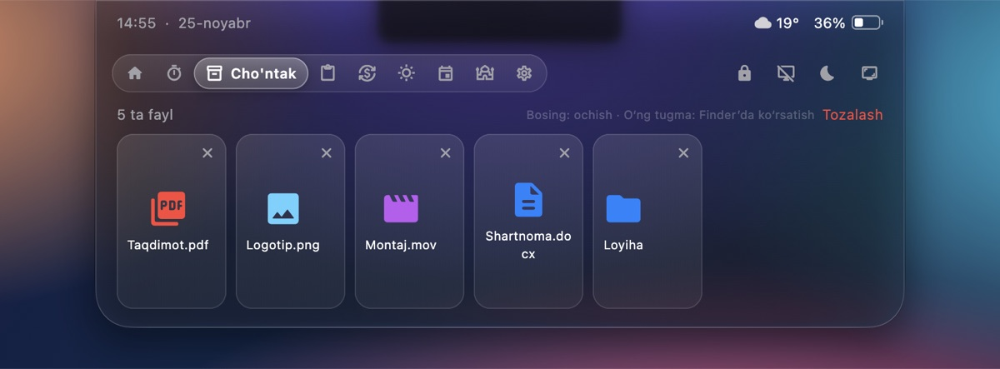
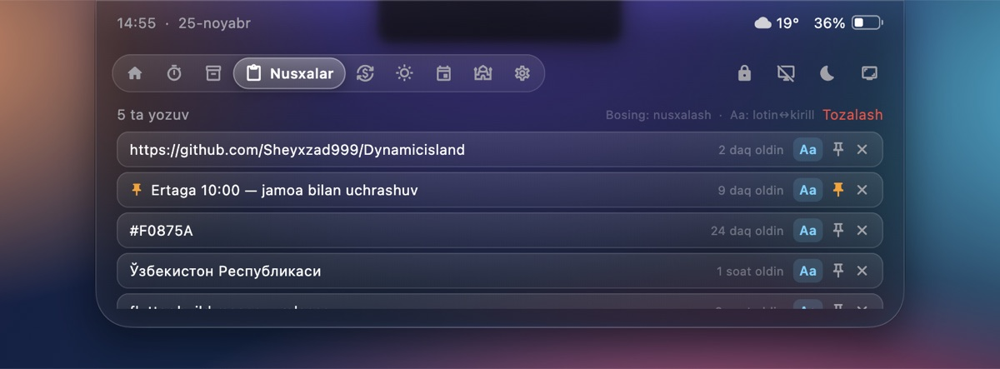
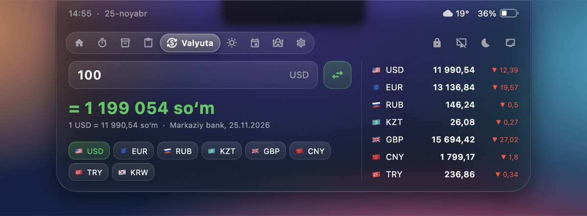
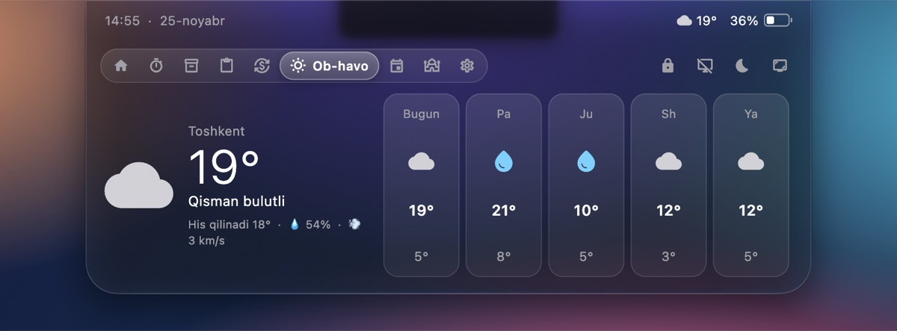
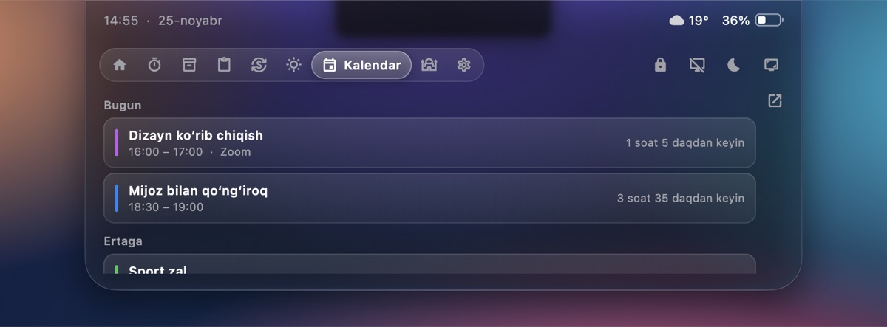
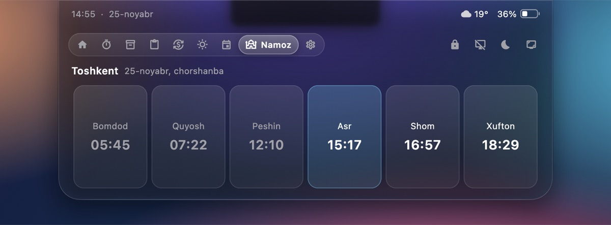
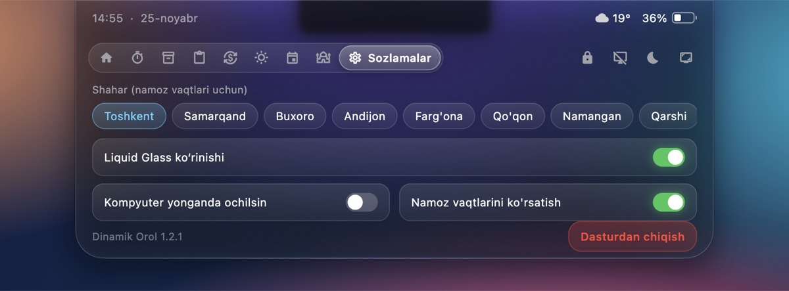

<div align="center">



# Dinamik Orol

**MacBook notch'i uchun Dynamic Island — Liquid Glass bilan, oʻzbek tilida**
<br/>*A Dynamic Island for the MacBook notch — with Liquid Glass*

[](https://github.com/Sheyxzad999/Dynamicisland/actions/workflows/ci.yml)
[](https://github.com/Sheyxzad999/Dynamicisland/releases/latest)


[](LICENSE)

### [⬇️ Yuklab olish / Download](https://github.com/Sheyxzad999/Dynamicisland/releases/latest)

**[🇺🇿 Oʻzbekcha](#-oʻzbekcha)** · **[🇬🇧 English](#-english)**

</div>

---

# 🇺🇿 Oʻzbekcha

## Bu nima?

MacBook ekranining tepasidagi qora kesik (notch) hech qanday foyda keltirmaydi. **Dinamik Orol** uni iPhone'dagi *Dynamic Island* singari jonli vositaga aylantiradi:

- sichqonchani notch'ga olib borsangiz — orol **Liquid Glass** shisha panelga aylanib ochiladi;
- yopiq turganda esa muhim narsa notch yonida koʻrinib turadi: ijro etilayotgan musiqa, taymer, keyingi namoz yoki uchrashuv.

Dastur **Dock'da koʻrinmaydi** va menyu qatoriga xalaqit bermaydi — u faqat notch'da yashaydi.

## 💎 Liquid Glass



v1.2 dan boshlab ochilgan orol **Apple'ning haqiqiy Liquid Glass materialidan** (`NSGlassEffectView`) yasalgan: orqadagi ish stoli, oynalar va rasmlar shisha orqali xira koʻrinib turadi, shisha esa orolning ochilish animatsiyasiga kadrma-kadr ergashadi.

- **Yopiq holatda** orol sof qora — jismoniy notch bilan qoʻshilib ketadi.
- **macOS 26 dan eski** tizimlarda avtomatik ravishda shaffof xira shisha (`NSVisualEffectView`) ishlatiladi.
- Yoqmasa — **⚙️ Sozlamalar → Liquid Glass koʻrinishi** ni oʻchirib, klassik qora orolga qaytish mumkin.

## 🏝 Yopiq holatlar

Orol yopiq turganda notch'ning ikki yonida "qanotlar" paydo boʻladi:

| Musiqa ijro etilmoqda | Taymer ishlamoqda |
|:---:|:---:|
|  |  |

Shuningdek: uchrashuvgacha qolgan daqiqalar, keyingi namozgacha vaqt, zaryadlovchi ulanganda batareya animatsiyasi, mikrofon (🟠) yoki kamera (🟢) ishlatilayotganini bildiruvchi nuqtalar.

## 🧩 Boʻlimlar

| | |
|:---:|:---:|
| <br/>**⏱ Taymer** — 1 daqiqadan 2 soatgacha, pauza, +1 daqiqa, tugaganda ovozli signal | <br/>**📦 Choʻntak** — faylni notch ustiga sudrab tashlang, u shu yerda saqlanib turadi |
| <br/>**📋 Nusxalar** — oxirgi 50 ta matn, qadash, bir bosishda lotin ↔ kirill | <br/>**💵 Valyuta** — Markaziy bank kursi, kunlik oʻzgarish, kalkulyator |
| <br/>**🌤 Ob-havo** — hozirgi holat va 5 kunlik prognoz | <br/>**📅 Kalendar** — Mac kalendaridagi yaqin uchrashuvlar |
| <br/>**🕌 Namoz vaqtlari** — 14 ta shahar, vaqti kirganda ogohlantirish | <br/>**⚙️ Sozlamalar** — shahar, Liquid Glass, avtomatik ishga tushish |

<sub>Rasmlardagi maʼlumotlar namunaviy (demo rejim).</sub>

## ✨ Barcha imkoniyatlar

| | Boʻlim | Tavsif |
|---|---|---|
| 🎵 | **Musiqa** | Spotify va Apple Music: qoʻshiq nomi, muqovasi, vaqt chizigʻi, boshqaruv tugmalari. Ijro etilganda notch yonida ekvalayzer "oʻynaydi" |
| ⏱ | **Taymer** | Bir bosishda 1 daqiqadan 2 soatgacha. Pauza, +1 daqiqa, notch yonida orqaga sanash, tugaganda ovozli signal |
| 📦 | **Choʻntak** | Faylni notch ustiga sudrab tashlang. Bosilsa ochiladi, oʻng tugma bilan Finder'da koʻrsatiladi |
| 📋 | **Nusxalar tarixi** | Oxirgi 50 ta nusxalangan matn, qadab qoʻyish (📌), bir bosishda qayta nusxalash. Parol menejerlaridan nusxalangan matnlar saqlanmaydi |
| 🔤 | **Lotin ↔ Kirill** | Istalgan yozuvni bir bosishda boshqa alifboga oʻgirib nusxalaydi (oʻ, gʻ, sh, ch, ye, tutuq belgisi qoidalari bilan) |
| 💵 | **Valyuta** | Markaziy bankning 12 ta valyuta kursi, kunlik oʻzgarishi va soʻm ⇄ valyuta kalkulyatori |
| 🌤 | **Ob-havo** | Hozirgi harorat, namlik, shamol va 5 kunlik prognoz ([Open-Meteo](https://open-meteo.com)) |
| 📅 | **Kalendar** | Mac kalendaridagi 3 kunlik uchrashuvlar, boshlanishiga 10 daqiqa qolganda notch yonida sanash, boshlanganda ogohlantirish |
| 🕌 | **Namoz vaqtlari** | Oʻzbekistonning 14 ta shahri. Keyingi namozgacha qolgan vaqt, vaqt kirganda ogohlantirish |
| 🎙 | **Maxfiylik chiroqlari** | Mikrofon (🟠) yoki kamera (🟢) ishlatilayotganda notch yonida nuqta yonadi |
| ⚡ | **Tezkor amallar** | Ekranni qulflash, ekranni oʻchirish, uyqu rejimi, ekran rasmi (qulflash/uyqu ikki marta bosishni talab qiladi) |
| 🔋 | **Batareya** | Foiz, toʻlishigacha yoki tugashigacha qolgan vaqt. Zaryadlovchi ulanganda animatsiya |
| 💎 | **Liquid Glass** | Apple'ning haqiqiy shisha materiali (macOS 26+), sozlamalarda oʻchirish mumkin |

---

## 🍎 Mac'ga oʻrnatish

### Talablar
- **macOS 12 Monterey** yoki yangiroq (Liquid Glass uchun — **macOS 26** yoki yangiroq)
- **Notch'li MacBook** tavsiya etiladi: MacBook Pro 14"/16" (2021+), MacBook Air (2022+). Notch'siz ekranlarda orol menyu qatori oʻrtasida koʻrinadi.

### 1-qadam. Yuklab olish
[**Releases**](https://github.com/Sheyxzad999/Dynamicisland/releases/latest) sahifasini oching va pastdagi **Assets** boʻlimidan `Dinamik-Orol-vX.Y.Z-macOS.zip` faylini yuklab oling.

### 2-qadam. Applications papkasiga koʻchirish
1. **Downloads** (Загрузки) papkasida zip faylni ikki marta bosing — **Dinamik Orol** ilovasi paydo boʻladi.
2. Uni **Applications** (Программы) papkasiga sudrab tashlang.

### 3-qadam. Birinchi marta ochish
Dastur bepul va ochiq kodli, shuning uchun pullik Apple sertifikati bilan imzolanmagan. Birinchi ochishda macOS *"Apple tekshira olmadi…"* degan oyna chiqaradi. Uni ikki usulda oʻtish mumkin:

**A usul — Tizim sozlamalari orqali (tavsiya etiladi):**
1. Ogohlantirish oynasida **Done / Готово** ni bosing (⚠️ *Move to Trash* ni bosmang).
2. ** → System Settings → Privacy & Security** (Системные настройки → Конфиденциальность и безопасность) ni oching.
3. Pastga tushing va *"Dinamik Orol was blocked…"* yozuvi yonidagi **Open Anyway** (Всё равно открыть) ni bosing.
4. Parol yoki Touch ID bilan tasdiqlang va yana **Open** ni bosing.

**B usul — Terminal orqali (bitta buyruq):**
```bash
xattr -dr com.apple.quarantine "/Applications/Dinamik Orol.app"
```

### 4-qadam. Ruxsatlar
Birinchi ishlatishda macOS bir necha ruxsat soʻraydi — hammasiga **OK / Allow** bosing:

| Ruxsat | Nima uchun kerak |
|---|---|
| Spotify / Music'ni boshqarish | Qoʻshiq nomi, muqova va ⏮ ⏯ ⏭ tugmalari |
| Kalendar | Kalendar boʻlimi (boʻlimdagi **Ruxsat berish** tugmasi orqali) |
| Joylashuv kerak emas | Ob-havo va namoz vaqtlari tanlangan shahar boʻyicha olinadi |

### Qanday ishlatiladi
- **Ochish:** sichqonchani notch ustiga olib boring va bir lahza toʻxtating.
- **Yopish:** sichqonchani orol tashqarisiga olib chiqing.
- **Fayl saqlash:** faylni notch ustiga sudrab tashlang.
- **Kompyuter yonganda ishga tushsin:** ⚙️ Sozlamalar → *Kompyuter yonganda ochilsin*.
- **Dasturdan chiqish:** ⚙️ Sozlamalar → *Dasturdan chiqish*.

### Yangilash
1. ⚙️ Sozlamalar → **Dasturdan chiqish**.
2. Yangi versiyani yuklab oling va Applications'dagi eskisini **almashtiring** (Replace / Заменить).
3. Sozlamalar, choʻntak va nusxalar tarixi saqlanib qoladi.

### Oʻchirish
1. ⚙️ Sozlamalar → **Dasturdan chiqish**.
2. Applications papkasidan **Dinamik Orol** ni Korzinaga tashlang.

---

## 🪟 Windows

**Dinamik Orol Windows'da ishlamaydi** va bu yaqin orada oʻzgarmaydi. Sababi:

- dastur **MacBook notch'i** atrofida qurilgan — Windows noutbuklarida notch yoʻq;
- u faqat macOS'da mavjud tizim imkoniyatlariga tayanadi: shaffof `NSPanel` oyna, Liquid Glass (`NSGlassEffectView`), batareya uchun IOKit, musiqa uchun AppleScript, kalendar uchun EventKit.

**Windows uchun muqobil:** [**⚡ Tezkor**](https://github.com/Sheyxzad999/tezkor) — xuddi shu muallifning Mac **va Windows**'da ishlaydigan vidjetlar dasturi: namoz vaqtlari, Markaziy bank kursi, clipboard tarixi, tizim monitori, rang pipetkasi, timecode kalkulyator va dasturchi asboblari. Windows'ga oʻrnatish: Releases'dan `Tezkor_x.y.z_x64-setup.exe` ni yuklab, ishga tushiring (*"Windows protected your PC"* chiqsa — **More info → Run anyway**).

---

## ❓ Muammolar va yechimlar

| Muammo | Yechim |
|---|---|
| Orol koʻrinmayapti | Dastur ishlab turganini tekshiring (Activity Monitor → *Dinamik Orol*). Tashqi monitor ulangan boʻlsa, orol notch'li ekranda chiqadi |
| Musiqa koʻrinmayapti | Faqat **Spotify** va **Apple Music** qoʻllab-quvvatlanadi. System Settings → Privacy & Security → **Automation** da Dinamik Orol'ga ruxsat berilganini tekshiring |
| Kalendar boʻsh | Kalendar boʻlimidagi **Ruxsat berish** tugmasini bosing yoki Privacy & Security → **Calendars** da ruxsat bering |
| Tugmalar bosilmaydi (v1.2.0) | Eng soʻnggi versiyaga yangilang — bu xato v1.2.1 da tuzatilgan |
| Shisha juda shaffof yoki yoqmaydi | ⚙️ Sozlamalar → *Liquid Glass koʻrinishi* ni oʻchiring |

---

## 🛠 Manba koddan yigʻish

Kerak: [Flutter 3.x](https://docs.flutter.dev/get-started/install/macos), Xcode (Liquid Glass uchun Xcode 26+).

```bash
git clone https://github.com/Sheyxzad999/Dynamicisland.git
cd Dynamicisland
flutter pub get
flutter test                      # testlar
flutter run -d macos              # ishlab chiqish rejimi
flutter build macos --release     # tayyor .app
```

Tayyor dastur: `build/macos/Build/Products/Release/Dinamik Orol.app`

**Demo rejim** (skrinshotlar uchun, haqiqiy maʼlumotlar oʻqilmaydi):
```bash
flutter run -d macos --dart-define=OROL_DEMO=0       # orol ochiq, 0-boʻlim
flutter run -d macos --dart-define=OROL_DEMO=cycle   # boʻlimlar navbat bilan almashadi
```

## 🏗 Arxitektura

```
lib/
├── main.dart              # Orol: holatlar, shakl animatsiyasi, asosiy boʻlimlar
├── native.dart            # Swift bilan MethodChannel aloqasi
├── prayer.dart            # Namoz vaqtlari (AlAdhan API + kesh)
├── translit.dart          # Lotin ↔ Kirill oʻgirgich
├── ui.dart                # Ranglar, shisha plitkalar, formatlash
├── services/              # Nusxalar, valyuta (CBU), ob-havo, kalendar
└── tabs/                  # Nusxalar, Valyuta, Ob-havo, Kalendar boʻlimlari
macos/Runner/
└── MainFlutterWindow.swift   # Shaffof panel, Liquid Glass qatlami, sichqoncha kuzatuvi,
                              # batareya (IOKit), musiqa (AppleScript), nusxalar (NSPasteboard),
                              # mikrofon/kamera (CoreAudio/CoreMediaIO), EventKit
```

**Qanday ishlaydi:** Flutter notch ustida turadigan shaffof `NSPanel` ichida chiziladi. Swift har 40 ms da sichqoncha holatini tekshiradi: kursor orol ichida boʻlmasa, panel bosishlarni orqadagi oynalarga oʻtkazib yuboradi. Liquid Glass qatlami Flutter koʻrinishi **ortida** turadi; Flutter har animatsiya kadrida orol oʻlchamini Swift'ga yuboradi va shisha unga ergashadi. Shisha sichqoncha hodisalarini qabul qilmaydi — u faqat bezak qatlam.

## ⚠️ Cheklovlar

- Musiqa faqat **Spotify** va **Apple Music** dan oʻqiladi. Brauzerdagi YouTube kabi manbalarga macOS 15.4+ ruxsat bermaydi.
- "Bezovta qilmang" (Focus) rejimini boshqarish uchun macOS ochiq API bermaydi.
- Namoz vaqtlari [AlAdhan](https://aladhan.com) xizmatidan olinadi (MWL usuli, asr Hanafiy mazhabi boʻyicha) va Oʻzbekiston musulmonlari idorasi jadvalidan bir necha daqiqa farq qilishi mumkin.

## 🗺 Rejalar

- [x] Nusxalar tarixi va lotin ↔ kirill oʻgirgich
- [x] Valyuta kursi, ob-havo, kalendar
- [x] Liquid Glass
- [ ] Namoz vaqtlariga daqiqa tuzatishlari
- [ ] Choʻntakdan fayllarni sudrab olib chiqish
- [ ] Bir nechta monitor uchun sozlama

## 🤝 Hissa qoʻshish

Gʻoya va xatolar uchun [Issue](https://github.com/Sheyxzad999/Dynamicisland/issues) oching, kod uchun [CONTRIBUTING.md](CONTRIBUTING.md) ga qarang.

## 📄 Litsenziya

[MIT](LICENSE) © 2026 Sheyxzad999

---

# 🇬🇧 English

## What is it?

The black cut-out at the top of a MacBook screen (the notch) does nothing useful. **Dinamik Orol** ("Dynamic Island" in Uzbek) turns it into a live hub, much like the *Dynamic Island* on iPhone:

- move the pointer onto the notch and the island expands into a **Liquid Glass** panel;
- while collapsed, the important things stay visible beside the notch: the song that's playing, a running timer, the next prayer time or meeting.

The app has **no Dock icon** and never gets in the way of the menu bar — it lives only in the notch.

## 💎 Liquid Glass

Since v1.2 the expanded island is made of **Apple's real Liquid Glass material** (`NSGlassEffectView`): your desktop, windows and wallpaper are visible through the glass, and the glass follows the island's opening animation frame by frame.

- **When collapsed**, the island is pure black so it blends into the physical notch.
- **On macOS older than 26**, a translucent blurred material (`NSVisualEffectView`) is used automatically.
- Don't like it? Turn off **⚙️ Settings → Liquid Glass** to get the classic black island.

## 🧩 Features

| | Feature | Description |
|---|---|---|
| 🎵 | **Music** | Spotify and Apple Music: title, artwork, progress bar, playback controls; an animated equalizer beside the notch |
| ⏱ | **Timer** | One-tap presets from 1 minute to 2 hours, pause, +1 min, countdown beside the notch, sound when done |
| 📦 | **Shelf** | Drag files onto the notch to keep them handy; click to open, right-click to reveal in Finder |
| 📋 | **Clipboard history** | Last 50 copied texts, pinning, one-tap re-copy; text copied from password managers is never stored |
| 🔤 | **Latin ↔ Cyrillic** | Converts any Uzbek text to the other alphabet in one tap (handles oʻ, gʻ, sh, ch, ye and the apostrophe) |
| 💵 | **Currency** | 12 official Central Bank of Uzbekistan rates, daily change and a soʻm ⇄ currency converter |
| 🌤 | **Weather** | Current conditions and a 5-day forecast ([Open-Meteo](https://open-meteo.com)) |
| 📅 | **Calendar** | Meetings from the Mac Calendar for the next 3 days; countdown beside the notch 10 minutes before, alert when it starts |
| 🕌 | **Prayer times** | 14 cities in Uzbekistan, time left until the next prayer, alert when it begins |
| 🎙 | **Privacy dots** | An orange (mic) or green (camera) dot beside the notch while they are in use |
| ⚡ | **Quick actions** | Lock screen, display off, sleep, screenshot (lock/sleep require a second tap) |
| 🔋 | **Battery** | Percentage and time to full/empty; animation when the charger is connected |

The interface is in Uzbek (Latin script).

## 🍎 Installing on a Mac

**Requirements:** macOS 12 Monterey or later (**macOS 26+** for Liquid Glass). A MacBook with a notch is recommended (MacBook Pro 14"/16" 2021+, MacBook Air 2022+); on screens without a notch the island sits in the middle of the menu bar.

1. **Download** `Dinamik-Orol-vX.Y.Z-macOS.zip` from the **Assets** section of the [latest release](https://github.com/Sheyxzad999/Dynamicisland/releases/latest).
2. **Unzip** it (double-click in Downloads) and drag **Dinamik Orol** into **Applications**.
3. **Open it the first time.** The app is free and open source, so it is not signed with a paid Apple certificate and macOS will say it *"could not verify"* it. Either:
   - click **Done**, open ** → System Settings → Privacy & Security**, scroll down and click **Open Anyway** next to *"Dinamik Orol was blocked"*, then confirm; **or**
   - run once in Terminal:
     ```bash
     xattr -dr com.apple.quarantine "/Applications/Dinamik Orol.app"
     ```
4. **Allow permissions** when asked: control of Spotify/Music (for track info and controls) and Calendar (via the **Ruxsat berish** button in the Calendar tab). Location access is not needed.

**Using it:** hover over the notch and pause briefly to open; move away to close; drag files onto the notch to shelve them. Launch at login and *Quit* are in ⚙️ Settings.

**Updating:** ⚙️ Settings → *Dasturdan chiqish* (Quit), then replace the app in Applications with the new version. Your settings, shelf and clipboard history are kept.

**Uninstalling:** quit the app, then move it from Applications to the Trash.

## 🪟 Windows

**Dinamik Orol does not run on Windows.** It is built around the MacBook notch and relies on macOS-only system features (`NSPanel`, `NSGlassEffectView`, IOKit, AppleScript, EventKit).

**Windows alternative:** [**⚡ Tezkor**](https://github.com/Sheyxzad999/tezkor) by the same author runs on **Mac and Windows** and offers prayer times, Central Bank exchange rates, clipboard history, a system monitor, a color picker, a timecode calculator and developer tools. On Windows, download `Tezkor_x.y.z_x64-setup.exe` from its Releases and run it (if *"Windows protected your PC"* appears, click **More info → Run anyway**).

## ❓ Troubleshooting

| Problem | Fix |
|---|---|
| The island doesn't appear | Check the app is running (Activity Monitor → *Dinamik Orol*). With an external display, the island appears on the screen that has the notch |
| No music info | Only **Spotify** and **Apple Music** are supported. Check System Settings → Privacy & Security → **Automation** |
| Calendar is empty | Press **Ruxsat berish** in the Calendar tab or allow it under Privacy & Security → **Calendars** |
| Buttons don't respond (v1.2.0) | Update to the latest version — fixed in v1.2.1 |
| Don't like the glass | ⚙️ Settings → turn off *Liquid Glass koʻrinishi* |

## 🛠 Building from source

Requires [Flutter 3.x](https://docs.flutter.dev/get-started/install/macos) and Xcode (Xcode 26+ for Liquid Glass).

```bash
git clone https://github.com/Sheyxzad999/Dynamicisland.git
cd Dynamicisland
flutter pub get
flutter test
flutter run -d macos
flutter build macos --release
```

Demo mode for screenshots (no real data is read): `flutter run -d macos --dart-define=OROL_DEMO=cycle`.

**How it works:** Flutter renders inside a transparent `NSPanel` placed over the notch. Swift checks the pointer every 40 ms and lets clicks pass through to the windows behind when the pointer is outside the island. The Liquid Glass layer sits **behind** the Flutter view; on every animation frame Flutter sends the island's size to Swift and the glass follows it. The glass never receives mouse events — it is purely decorative.

## 📄 License

[MIT](LICENSE) © 2026 Sheyxzad999
