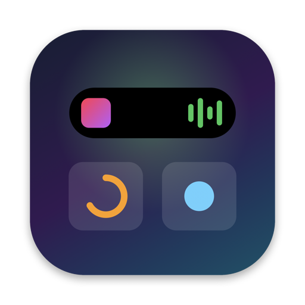

<div align="center">



# Dinamik Orol

**MacBook notch'i uchun Dynamic Island: o'zbek tilida**

Ekran tepasidagi qora kesikni foydali vositaga aylantiradi: musiqa, taymer, fayllar cho'ntagi, namoz vaqtlari va batareya, hammasi bitta joyda.

[](https://github.com/Sheyxzad999/Dynamicisland/actions/workflows/ci.yml)
[](https://github.com/Sheyxzad999/Dynamicisland/releases/latest)


[](LICENSE)

[**⬇️ Yuklab olish**](https://github.com/Sheyxzad999/Dynamicisland/releases/latest) · [Imkoniyatlar](#-imkoniyatlar) · [O'rnatish](#-ornatish) · [English](#english)

</div>

---

## ✨ Imkoniyatlar

Sichqonchani notch ustiga olib boring, orol kattalashib ochiladi. Yopiq turganda esa muhim ma'lumot notch yonida ko'rinib turadi.

| | Bo'lim | Tavsif |
|---|---|---|
| 🎵 | **Musiqa** | Spotify va Apple Music: qo'shiq nomi, muqovasi, vaqt chizig'i, boshqaruv tugmalari. Ijro etilganda notch yonida ekvalayzer "o'ynaydi" |
| ⏱ | **Taymer** | Bir bosishda 1 daqiqadan 2 soatgacha. Pauza, +1 daqiqa, notch yonida orqaga sanash, tugaganda ovozli signal |
| 📦 | **Cho'ntak** | Faylni notch ustiga sudrab tashlang, u saqlanib turadi. Bosilsa ochiladi, o'ng tugma bilan Finder'da ko'rsatiladi |
| 📋 | **Nusxalar tarixi** | Oxirgi 50 ta nusxalangan matn, qadab qo'yish (📌), bir bosishda qayta nusxalash. Parol menejerlaridan nusxalangan matnlar saqlanmaydi |
| 🔤 | **Lotin ↔ Kirill** | Istalgan yozuvni bir bosishda boshqa alifboga o'girib nusxalaydi (o‘, g‘, sh, ch, ye, tutuq belgisi qoidalari bilan) |
| 💵 | **Valyuta** | Markaziy bankning 12 ta valyuta kursi, kunlik o'zgarishi va so'm ⇄ valyuta kalkulyatori |
| 🌤 | **Ob-havo** | Hozirgi harorat, namlik, shamol va 5 kunlik prognoz ([Open-Meteo](https://open-meteo.com)) |
| 📅 | **Kalendar** | Mac kalendaridagi 3 kunlik uchrashuvlar, boshlanishiga 10 daqiqa qolganda notch yonida sanash, boshlanganda ogohlantirish |
| 🕌 | **Namoz vaqtlari** | O'zbekistonning 14 ta shahri. Keyingi namozgacha qolgan vaqt, vaqt kirganda ogohlantirish |
| 🎙 | **Maxfiylik chiroqlari** | Mikrofon (🟠) yoki kamera (🟢) ishlatilayotganda notch yonida nuqta yonadi |
| ⚡ | **Tezkor amallar** | Ekranni qulflash, ekranni o'chirish, uyqu rejimi, ekran rasmi |
| 🔋 | **Batareya** | Foiz, to'lishigacha yoki tugashigacha qolgan vaqt. Zaryadlovchi ulanganda iPhone'dagidek animatsiya |
| ⚙️ | **Sozlamalar** | Shahar tanlash, kompyuter yonganda avtomatik ishga tushish |

### Holatlar

```
 Yopiq:          ▀▀▀▀▀▀▀▀▀▀▀              (oddiy notch)
 Musiqa:     🎨  ▀▀▀▀▀▀▀▀▀▀▀  ▁▃▅▂         (muqova + ekvalayzer)
 Taymer:     ⏱  ▀▀▀▀▀▀▀▀▀▀▀  04:59
 Uchrashuv:  📅  ▀▀▀▀▀▀▀▀▀▀▀  8 daq
 Mikrofon:       ▀▀▀▀▀▀▀▀▀▀▀  🟠
 Zaryad:  Zaryadlanmoqda ▀▀▀▀▀▀▀▀▀▀▀ 76% 🔋
 Ochiq:   ┌──────────────────────────────────┐
          │ 🏠 ⏱ 📦 🕌 ⚙️  ▀▀▀▀▀▀▀▀   Asosiy 82% │
          │  ┌────┐  Qo'shiq nomi    │ Peshin   │
          │  │ 🎨 │  Ijrochi          │ 12:08    │
          │  └────┘  ━━━━━━──── ⏮ ⏯ ⏭ │ 🔋 82%   │
          └──────────────────────────────────┘
```

## 📥 O'rnatish

1. [Releases](https://github.com/Sheyxzad999/Dynamicisland/releases/latest) sahifasidan `Dinamik-Orol-...-macOS.zip` faylini yuklab oling.
2. Arxivni oching va **Dinamik Orol.app** ni **Programs (Applications)** papkasiga ko'chiring.
3. Dastur Apple tomonidan imzolanmagan, shuning uchun birinchi ochishda Terminal'da quyidagini bajaring:
   ```bash
   xattr -dr com.apple.quarantine "/Applications/Dinamik Orol.app"
   ```
   Yoki ikonkani **o'ng tugma → Ochish (Open)** orqali oching.
4. macOS ruxsat so'raganda **OK** ni bosing: musiqa uchun (Spotify/Music boshqaruvi) va kalendar uchun (Kalendar bo'limidagi "Ruxsat berish" tugmasi).

> 💡 Dasturning Dock'da ikonkasi yo'q, u faqat notch'da yashaydi. Yopish uchun: **⚙️ Sozlamalar → Dasturdan chiqish**.

### Talablar
- macOS 12 Monterey yoki yangiroq
- Notch'li MacBook (2021+ MacBook Pro, 2022+ MacBook Air) tavsiya etiladi. Notch'siz ekranlarda orol menyu qatori o'rtasida ko'rinadi.

## 🛠 Manba koddan yig'ish

```bash
git clone https://github.com/Sheyxzad999/Dynamicisland.git
cd Dynamicisland
flutter pub get
flutter test                      # testlar
flutter run -d macos              # ishlab chiqish rejimi
flutter build macos --release     # tayyor .app
```

Tayyor dastur: `build/macos/Build/Products/Release/Dinamik Orol.app`

## 🏗 Arxitektura

```
lib/
├── main.dart              # Orol: holatlar, animatsiyalar, asosiy bo'limlar
├── native.dart            # Swift bilan MethodChannel aloqasi
├── prayer.dart            # Namoz vaqtlari (AlAdhan API + kesh)
├── translit.dart          # Lotin ↔ Kirill o'girgich
├── ui.dart                # Ranglar, formatlash, umumiy vidjetlar
├── services/              # Nusxalar, valyuta (CBU), ob-havo, kalendar
└── tabs/                  # Nusxalar, Valyuta, Ob-havo, Kalendar bo'limlari
macos/Runner/
└── MainFlutterWindow.swift   # Shaffof panel, sichqoncha kuzatuvi, batareya (IOKit),
                              # musiqa (AppleScript), nusxalar (NSPasteboard),
                              # mikrofon/kamera (CoreAudio/CoreMediaIO), EventKit
test/                      # Unit testlar (flutter test)
tool/make_icon.swift       # Ikonka generatori
```

**Qanday ishlaydi:** Flutter notch ustida turadigan shaffof `NSPanel` ichida chiziladi. Swift har 40 ms da sichqoncha holatini tekshiradi: kursor orol ichida bo'lmasa, panel bosishlarni orqadagi oynalarga o'tkazib yuboradi. Shuning uchun dastur menyu qatoriga xalaqit bermaydi.

## ⚠️ Cheklovlar

- Musiqa faqat **Spotify** va **Apple Music** dan o'qiladi. Brauzerdagi YouTube kabi manbalarga macOS 15.4+ ruxsat bermaydi.
- "Bezovta qilmang" (Focus) rejimini boshqarish uchun macOS ochiq API bermaydi, shuning uchun u tezkor amallarga kiritilmagan.
- Namoz vaqtlari [AlAdhan](https://aladhan.com) xizmatidan olinadi (MWL usuli, asr Hanafiy mazhabi bo'yicha) va O'zbekiston musulmonlari idorasi jadvalidan bir necha daqiqa farq qilishi mumkin.

## 🗺 Rejalar

- [x] Nusxalar tarixi va lotin ↔ kirill o'girgich
- [x] Valyuta kursi (Markaziy bank)
- [x] Ob-havo
- [x] Kalendar tadbirlari
- [ ] Namoz vaqtlariga daqiqa tuzatishlari
- [ ] Cho'ntakdan fayllarni sudrab olib chiqish
- [ ] Bir nechta monitor uchun sozlama

## 🤝 Hissa qo'shish

G'oya va xatolar uchun [Issue](https://github.com/Sheyxzad999/Dynamicisland/issues) oching, kod uchun esa [CONTRIBUTING.md](CONTRIBUTING.md) ga qarang.

## 📄 Litsenziya

[MIT](LICENSE) © 2026 Sheyxzad999

---

<a name="english"></a>

## English

**Dinamik Orol** ("Dynamic Island" in Uzbek) turns the MacBook notch into a useful hub: a Spotify / Apple Music player, a timer, a drag-and-drop file shelf, clipboard history with Latin ↔ Cyrillic Uzbek transliteration, official Central Bank of Uzbekistan exchange rates with a converter, weather, upcoming calendar events, Islamic prayer times for 14 Uzbek cities, mic/camera privacy indicators, quick actions and battery status with a charging animation. Hover over the notch to expand it; live activities show beside the notch while it is collapsed.

Built with **Flutter** and a small native **Swift** layer: a transparent click-through `NSPanel`, IOKit battery info, AppleScript media control and `SMAppService` launch-at-login.

**Install:** download the zip from [Releases](https://github.com/Sheyxzad999/Dynamicisland/releases/latest), move the app to `/Applications`, then run `xattr -dr com.apple.quarantine "/Applications/Dinamik Orol.app"` (the app is not notarized). Requires macOS 12+.
